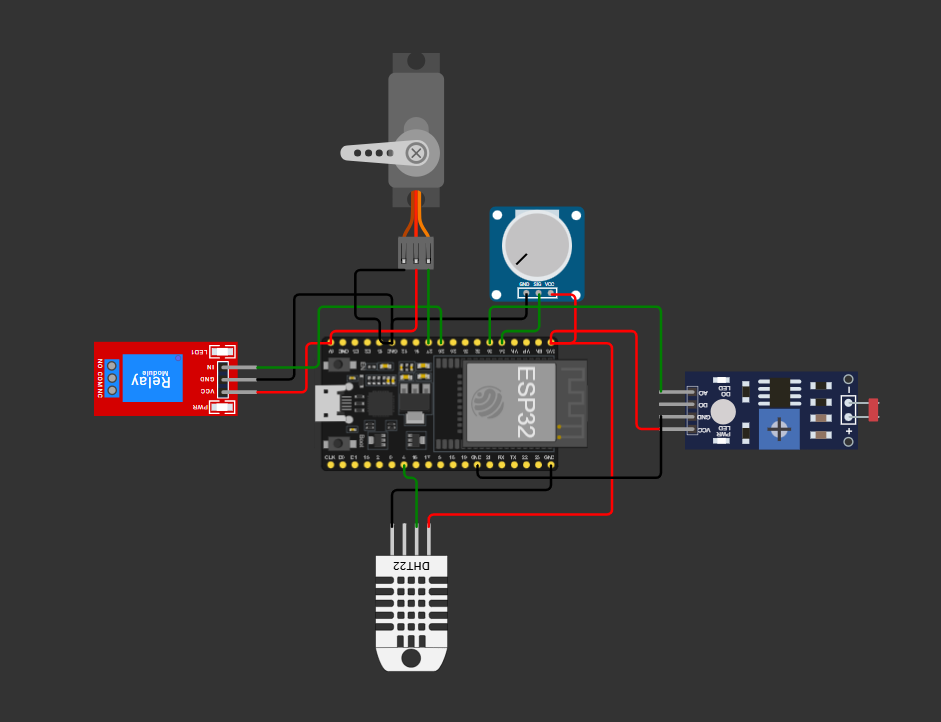

# Projeto 2 - Estufa inteligente na plataforma FIWARE

CCM520 - Internet das Coisas | Centro Universitário FEI

## 1. Identificação

| Campo | Valor |
|---|---|
| Integrantes | Guilherme Silva Xavier |
| API key do grupo | `0257` |
| Dispositivo | `estufa001` |
| Entidade NGSI | `urn:ngsi-ld:Greenhouse:001` (tipo `Greenhouse`) |
| Serviço / caminho | `fei` / `/estufa` |
| Projeto no Wokwi | https://wokwi.com/projects/480727085541271553 |

## 2. Visão geral

A estufa (ESP32 simulada no Wokwi) publica suas medidas em um único JSON e recebe comandos pelo Orion, sem que as aplicações precisem conhecer MQTT, tópicos ou broker. O IoT Agent JSON faz a tradução entre o MQTT da estufa e o NGSI-v2 do Orion. O histórico segue para o MySQL pelo Cygnus e é exibido em um painel do Grafana, e um serviço consumidor recebe o alerta de solo seco.

Caminho das medidas (norte):

```
ESP32 / Wokwi -> broker.hivemq.com -> ponte -> Mosquitto local -> IoT Agent JSON -> Orion -> subscrições (Cygnus e alerta)
```

Caminho dos comandos (sul):

```
Orion -> IoT Agent JSON -> Mosquitto local -> ponte -> broker.hivemq.com -> ESP32 / Wokwi
```

Histórico e visualização: `Orion -> Cygnus -> MySQL -> Grafana`.

| Serviço | Porta (host) | Uso |
|---|---|---|
| Orion (+ MongoDB) | 1026 | API NGSI-v2 |
| IoT Agent JSON | 4041 | provisionamento (grupos e dispositivos) |
| Mosquitto | 1883 | broker local, lado da ponte |
| Cygnus | 5050 / 5080 | notificações do Orion / API de gestão |
| Grafana | 3000 | painel |
| Consumidor | 3001 | alertas (o Orion o acessa como `consumidor:3000`) |
| MySQL | 3306 | banco `fei`, tabela `estufa` |

## 3. Como executar

### 3.1 Subir o ambiente

Na pasta `plataforma/`:

```bash
docker compose up -d
docker compose ps
```

Todos os serviços devem estar `running` (o MySQL, `healthy`). Para encerrar sem perder dados, use `docker compose stop`. Evite `docker compose down -v`, que apaga os volumes.

### 3.2 Configurar a ponte (`mosquitto/mosquitto.conf`)

1. Troque a API key nas três últimas linhas `topic`:

```
topic /json/0257/estufa001/attrs in 0
topic /json/0257/estufa001/cmdexe in 0
topic /0257/estufa001/cmd out 0
```

2. Troque o `remote_clientid` por um valor próprio (neste projeto: `062005`), para não colidir com outros clientes do broker público.
3. Reinicie o Mosquitto: `docker compose restart mosquitto`.

| Tópico | Direção | Quem publica |
|---|---|---|
| `/json/0257/estufa001/attrs` | in (HiveMQ -> local) | ESP32 |
| `/json/0257/estufa001/cmdexe` | in (HiveMQ -> local) | ESP32 |
| `/0257/estufa001/cmd` | out (local -> HiveMQ) | IoT Agent |

### 3.3 Testar a ponte

**Norte (HiveMQ -> Mosquitto local)**

1. Em `plataforma/`, deixe o Mosquitto escutando:

```bash
docker compose exec mosquitto mosquitto_sub -h localhost -p 1883 -v -t "/json/0257/#"
```

O comando fica travado esperando mensagens, e isso é normal.

2. Abra o [HiveMQ WebSocket Client](https://www.hivemq.com/demos/websocket-client/), use o host `broker.hivemq.com` e clique em **Connect** (aguarde o indicador ficar verde).
3. Em **Publish**, use o tópico `/json/0257/estufa001/attrs` e uma mensagem como `{"t": 24.8}`.
4. O terminal deve mostrar o tópico e o JSON recebidos.

**Sul (Mosquitto local -> HiveMQ)**

1. No WebSocket Client, conectado, vá em **Subscriptions**, clique em **Add New Topic Subscription** e use `/0257/#`.
2. No terminal, em `plataforma/`:

```bash
docker compose exec mosquitto mosquitto_pub -h localhost -p 1883 -t "/0257/estufa001/cmd" -m '{"setRelay": 1}'
```

3. A mensagem deve aparecer na área **Messages** do WebSocket Client.

Esse teste manual só valida a ponte. Na operação real, os comandos são enviados pelo Orion (seção 6.4), e não publicados à mão no broker.

## 4. Circuito no Wokwi

Os componentes e o código MicroPython partem do link do Projeto 1. A ESP32 permite ligar vários componentes no mesmo 3V3, 5V e GND.

| Componente | Alimentação | Sinal |
|---|---|---|
| DHT22 | VCC -> 3V3, GND -> GND | SDA -> GPIO4 (o pino NC fica sem ligação) |
| LDR (módulo) | VCC -> 3V3, GND -> GND | AO -> GPIO35 |
| Relé | VCC -> VIN (5V) ou 3V3, GND -> GND | IN -> GPIO26 (os bornes NO, COM e NC não precisam de ligação) |
| Servomotor | V+ -> VIN (5V), GND -> GND | PWM -> GPIO27 |
| Potenciômetro (simula o sensor de solo) | VCC -> 3V3, GND -> GND | SIG -> GPIO34 |

Verificação do circuito, só com as ligações e sem o código: inicie a simulação e confira as medidas de temperatura e umidade do DHT22 e a de luminosidade do LDR.



## 5. Firmware

Arquivo: `firmware/main.py` (MicroPython, ESP32). Wi-Fi do Wokwi: `Wokwi-GUEST`, sem senha. Client id MQTT: `esp32_0257_estufa001`.

| Sentido | Tópico |
|---|---|
| Medidas (publica) | `/json/0257/estufa001/attrs` |
| Comandos (assina) | `/0257/estufa001/cmd` |
| Resultado (publica) | `/json/0257/estufa001/cmdexe` |

### Calibração

| Constante | Valor | Critério |
|---|---|---|
| `SOIL_DRY_RAW` | 0 |
| `SOIL_WET_RAW` | 4095 |
| `LIGHT_DARK_RAW` | 0 |
| `LIGHT_BRIGHT_RAW` | 4095 |
| Servo (`duty` em 0° e 180°) |

## 6. Plataforma FIWARE

Cabeçalhos de todas as requisições ao IoT Agent e ao Orion:

| Key | Value |
|---|---|
| `fiware-service` | `fei` |
| `fiware-servicepath` | `/estufa` |
| `Content-Type` | `application/json` |

### 6.1 Modelo de dados

| Grandeza | Atributo NGSI | `object_id` | Tipo | Faixa |
|---|---|---|---|---|
| Temperatura do ar | `temperature` | `t` | Number | °C |
| Umidade relativa do ar | `relativeHumidity` | `rH` | Number | % |
| Umidade do solo | `soilMoisture` | `sM` | Number | 0 seco, 100 encharcado |
| Luminosidade | `illuminance` | `ilm` | Number | 0 escuro, 100 claro |
| Estado do relé | `relayState` | `rS` | Number | 0 ou 1 |
| Ângulo da janela | `windowAngle` | `wA` | Number | 0 a 180 |
| Intervalo de coleta | `samplingInterval` | `sI` | Number | 2 a 10 s |

| Comando | Valor | Efeito |
|---|---|---|
| `setRelay` | 0 ou 1 | desliga / liga o relé |
| `setServo` | 0 a 180 | posiciona a janela |
| `setInterval` | 2 a 10 | intervalo de coleta (s) |
| `setSending` | 0 ou 1 | desativa / ativa o envio das medidas |

Atributos estáticos: `name` (Text, `Estufado`) e `location` (geo:json, Point `[-46.63, -23.55]`, na ordem longitude, latitude).

A estufa responde todo comando com `OK` ou `ERRO: <motivo>`. Valor inválido nunca altera o estado, e com `setSending = 0` as medidas param, mas os comandos continuam funcionando.

### 6.2 Grupo de serviço

`POST http://localhost:4041/iot/groups`

```json
{
  "groups": [
    {
      "apikey": "0257",
      "entity_type": "Greenhouse",
      "resource": "/iot/json",
      "cbroker": "http://orion:1026",
      "autoprovision": false
    }
  ]
}
```

### 6.3 Dispositivo da estufa

`POST http://localhost:4041/iot/devices` (as variáveis `{{device_id}}` e `{{entidade}}` valem `estufa001` e `urn:ngsi-ld:Greenhouse:001`)

```json
{
  "devices": [
    {
      "device_id": "{{device_id}}",
      "apikey": "0257",
      "entity_name": "{{entidade}}",
      "entity_type": "Greenhouse",
      "transport": "MQTT",
      "attributes": [
        { "object_id": "t", "name": "temperature", "type": "Number" },
        { "object_id": "rH", "name": "relativeHumidity", "type": "Number" },
        { "object_id": "sM", "name": "soilMoisture", "type": "Number" },
        { "object_id": "ilm", "name": "illuminance", "type": "Number" },
        { "object_id": "rS", "name": "relayState", "type": "Number" },
        { "object_id": "wA", "name": "windowAngle", "type": "Number" },
        { "object_id": "sI", "name": "samplingInterval", "type": "Number" }
      ],
      "commands": [
        { "name": "setRelay", "type": "command" },
        { "name": "setServo", "type": "command" },
        { "name": "setInterval", "type": "command" },
        { "name": "setSending", "type": "command" }
      ],
      "static_attributes": [
        { "name": "name", "type": "Text", "value": "Estufado" },
        { "name": "location", "type": "geo:json", "value": { "type": "Point", "coordinates": [-46.63, -23.55] } }
      ]
    }
  ]
}
```

### 6.4 Comandos pelo Orion

`PATCH http://localhost:1026/v2/entities/urn:ngsi-ld:Greenhouse:001/attrs`

Ligar o relé (use `0` para desligar):

```json
{ "setRelay": { "type": "command", "value": 1 } }
```

Posicionar o servo (0 a 180):

```json
{ "setServo": { "type": "command", "value": 90 } }
```

Mudar o intervalo de coleta (2 a 10 segundos):

```json
{ "setInterval": { "type": "command", "value": 5 } }
```

Desligar o envio das medidas (use `1` para religar):

```json
{ "setSending": { "type": "command", "value": 0 } }
```

Acompanhe o ciclo do comando pelos atributos `<comando>_status` (de `PENDING` para `OK`) e `<comando>_info` da entidade.

### 6.5 Subscrição do histórico (Cygnus)

`POST http://localhost:1026/v2/subscriptions`

```json
{
  "description": "Historico das estufas para o Cygnus",
  "subject": { "entities": [{ "idPattern": ".*", "type": "Greenhouse" }] },
  "notification": {
    "http": { "url": "http://cygnus:5050/notify" },
    "attrs": ["temperature", "relativeHumidity", "soilMoisture", "illuminance", "relayState", "windowAngle", "samplingInterval"],
    "attrsFormat": "normalized"
  }
}
```

### 6.6 Subscrição de alerta (solo seco)

`POST http://localhost:1026/v2/subscriptions`

```json
{
  "description": "soil Moisture below 30",
  "subject": {
    "entities": [ { "id": "urn:ngsi-ld:Greenhouse:001", "type": "Greenhouse" } ],
    "condition": {
      "attrs": [ "soilMoisture" ],
      "expression": { "q": "soilMoisture<30" }
    }
  },
  "notification": {
    "http": { "url": "http://consumidor:3000/alerta-estufa" },
    "attrs": [ "soilMoisture", "relayState", "TimeInstant" ],
    "attrsFormat": "keyValues"
  },
  "throttling": 60
}
```

As notificações recebidas podem ser vistas em `http://localhost:3001/notificacoes?caminho=/alerta-estufa`.

## 7. Painel no Grafana

Acesso: `http://localhost:3000/`. Dashboard **Estufa inteligente**, atualização automática de 5 s, fonte MySQL com o usuário somente leitura `grafana` (banco `fei`).

| Item | Painel | Atributo(s) |
|---|---|---|
| a | Série temporal | `temperature` e `relativeHumidity` |
| b | Série temporal | `soilMoisture` |
| c | State timeline | `relayState` |
| d | Stat ou Gauge | `illuminance` (valor atual) |

O Cygnus grava todas as colunas como texto, então as consultas usam `CAST` no `SELECT`, e nunca dentro das macros `$__timeFilter`. Exportação: `grafana/painel-estufa.json`.

## 8. Testes e demonstração

Roteiro do ciclo completo:

1. `setRelay = 1` enviado pelo Orion.
2. A estufa responde e o Orion mostra `setRelay_status` e `setRelay_info`.
3. A nova medida traz `relayState = 1`.
4. O Cygnus grava no MySQL.
5. O Grafana mostra o relé ligado.

Coleção Postman: rode as pastas no Runner com a estufa ligada e o Wokwi em primeiro plano, com um **delay de 3000 a 5000 ms** entre as requisições. Sem ele, algumas verificações falham porque consultam o Orion antes de a resposta da ESP32 voltar pelo broker público. Os resultados exportados ficam em `postman/`.

## 9. Segurança e decisões de projeto

Para a concepção do projeto foi entendido os riscos de usar um broker público como o `broker.hivemq.com` e as possibilidades de qualquer pessoa conseguir interceptar as mensagens e altera-las, o que mexeria no funcionamento da estufa. Para mitigar esses efeitos foi usada uma chave de API única para transmitir as mensagens, o código no micropython verifica os comandos das requisições conforme os equipamentos, uso do `autoprovision` para evitar que outros dispositivos sejam cadastrados de repente.
Ainda assim há riscos de usar o broker público para projetos mais profissionais, tratando-se de aprendizagem o `broker.hivemq.com` cumpre bem a função de serviços gratuitos.

## 10. Estrutura do repositório

```
projeto2-<Nome>-0257/
├── README.md
├── firmware/main.py
├── plataforma/
│   ├── docker-compose.yml
│   └── mosquitto/ mysql/ servicos/
├── postman/
├── grafana/painel-estufa.json
└── relatorio.pdf
```

## 11. Referências

- Materiais de aula do Moodle e projetos anteriores praticados em aula
- fiware-iotagent-json.readthedocs.io
- fiware-orion.readthedocs.io
- hivemq.com/mqtt
